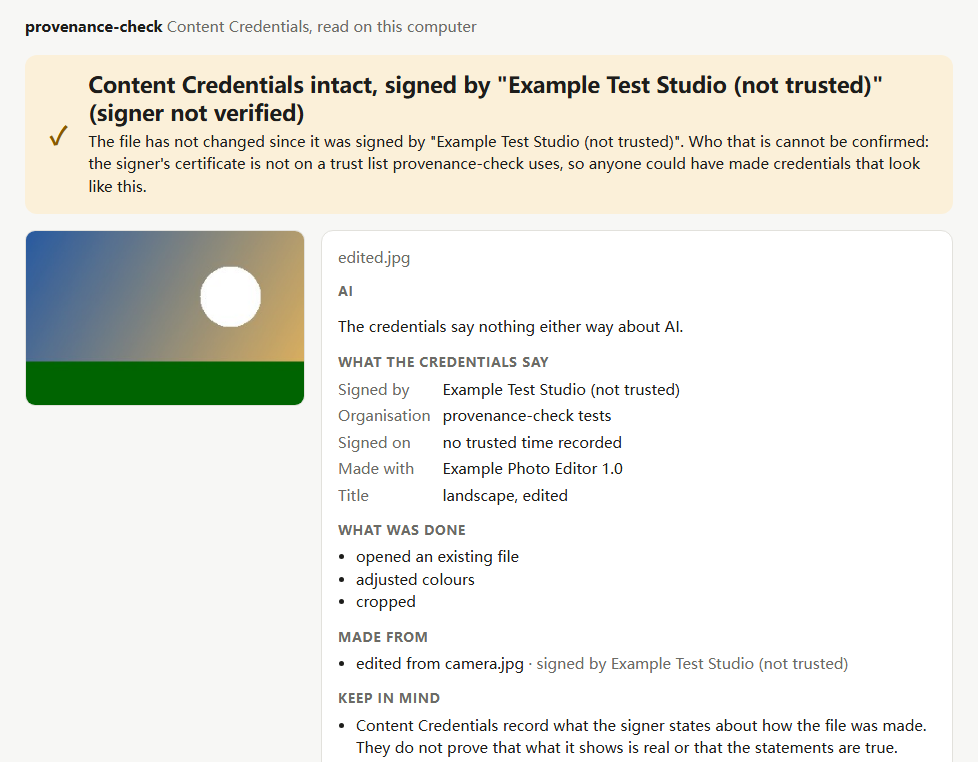
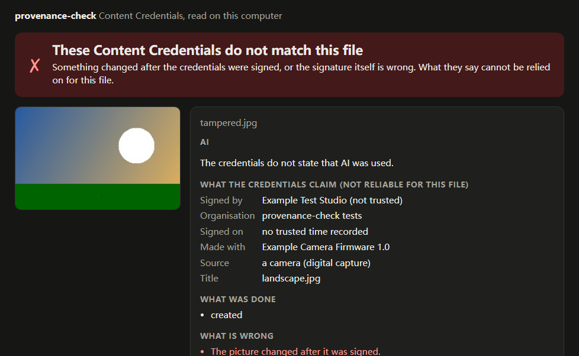

<div align="center">

# provenance-check

**Right-click an image, see what its Content Credentials say.** Who signed it, with what tool, whether AI made
it, what was edited, and whether the file changed since it was signed. In plain words, with what that does
*not* prove. Read on your computer with the C2PA reference library; nothing is uploaded.

<a href="https://github.com/zch6a/provenance-check/actions/workflows/ci.yml"></a>

<a href="LICENSE"></a>

**English** · [简体中文](README.zh-CN.md)

</div>

---



## What it tells you

[Content Credentials](https://contentcredentials.org) (the C2PA standard) are signed records that cameras,
editors and AI image generators can attach to a file. provenance-check reads them and says:

- **Whether the file changed since it was signed.** "Intact", or "These Content Credentials do not match this
  file", with what changed (the picture, part of the credentials, the signature).
- **Who signed it**, and whether that signer can be confirmed (see [trust](#what-it-does-not-do-yet)).
- **Whether AI was involved**, as the credentials state it: made by generative AI, edited with it, or made
  from a file that was; or that they say nothing about AI.
- **How it was made and changed**: the source (a camera, generative AI, a screenshot ...), the tool, the edits
  (cropped, colours adjusted ...), and the files it was made from, each with its own signer.
- **What that does not prove**, every time: credentials record what the signer states; they do not show that
  a scene is real. And no credentials at all is the normal case online, not a sign of a fake.



## Use

- On a web page, right-click an image (or a video or audio) and choose **Check Content Credentials**. The report
  opens in a new tab. The first time for a site, the browser asks you to let provenance-check fetch images from
  it (or from all sites).
- To check a file on your computer, click the toolbar icon, then **Check a file…**, and drop the file in.

## Install

Not in the Chrome Web Store yet. From the source (Node 18 or later):

```bash
git clone https://github.com/zch6a/provenance-check
cd provenance-check
npm ci
npm run build
```

Then open `chrome://extensions` (or `edge://extensions`), turn on **Developer mode**, choose **Load unpacked**
and pick the `dist` folder. Chrome and Edge 116 or later.

## Private by design

- The image is read **on your computer**, by the C2PA reference library ([c2pa-rs](https://github.com/contentauth/c2pa-rs),
  compiled to WebAssembly) that ships inside the extension. Nothing is uploaded, no account, no telemetry.
- The only request it makes is fetching the image once more from the site the page got it from (from the
  browser's cache when it can), and only after you allowed that site.
- It does **not** follow credentials that a file only points to by URL ("remote manifests"): doing so would tell
  that server which image you are looking at. The report says where they are, and leaves the choice to you.
  It does not look up certificate revocation (OCSP) either. Tests check that reading fetches nothing.
- It asks for one permission (the right-click menu). Access to a site's images is optional and asked for when
  needed; no script runs inside web pages.
- Text from credentials (titles, tool names) is written by whoever made the file. The report shows it as text,
  never as HTML; a test image with HTML in its title checks that.

## What it does not do (yet)

- **Trust.** It does not yet check signers against the C2PA trust list, so every signer shows as "not verified":
  the report tells you who signed, and you judge the name. (Anyone can make a certificate called "Famous News
  Agency"; the trust list is what tells the real one apart.)
- It reads what is inside the file: not invisible watermarks or fingerprints that lead to credentials stored
  elsewhere.
- It cannot tell whether an image *without* credentials was made by AI. Nothing reliable can.
- Images that exist only inside a page (`blob:` addresses) cannot be fetched from outside it: save them and
  check the file. Files up to 250 MB.
- Firefox: not yet (it needs a different background script setup).

## Other tools

Other browser extensions read Content Credentials, among them "C2PA Content Credentials", Digimarc's (open
source, on the older C2PA-JS library) and Adobe's Content Authenticity, and
[contentcredentials.org/verify](https://contentcredentials.org/verify) checks files you upload. provenance-check
is for people who want the check done locally, the result in plain words with its limits, and a small
open-source code base they can read: MIT, a few hundred lines on top of the reference library.

## Status

0.1, in development. Tested with synthetic images signed for the tests by the reference library with a test-only
certificate (`test/fixtures`, made by `scripts/make-fixtures.mjs`): an AI-generated image, a camera image, an
edit with its history, a tampered copy, one without credentials, one with credentials stored elsewhere, one with
HTML in its texts. The report page is checked in a browser with the real WebAssembly reader.

## Develop

```bash
npm ci
npm test            # the reports for the test images, privacy (nothing fetched), the built extension
npm run check       # type-check the JavaScript (JSDoc types, tsc)
npm run build       # into dist/
node scripts/serve.mjs   # the report page outside the extension: http://localhost:5180/dist/report.html?src=/test/fixtures/edited.jpg
```

`npm run fixtures` remakes the test images (`scripts/cose.mjs` signs them; the library's WebAssembly build
expects the signer to return a complete COSE signature). `scripts/screenshot.mjs` takes the screenshots above.

## License

[MIT](LICENSE). It bundles [c2pa-web](https://github.com/contentauth/c2pa-js) (MIT, Adobe); its license is kept
in the built files.
