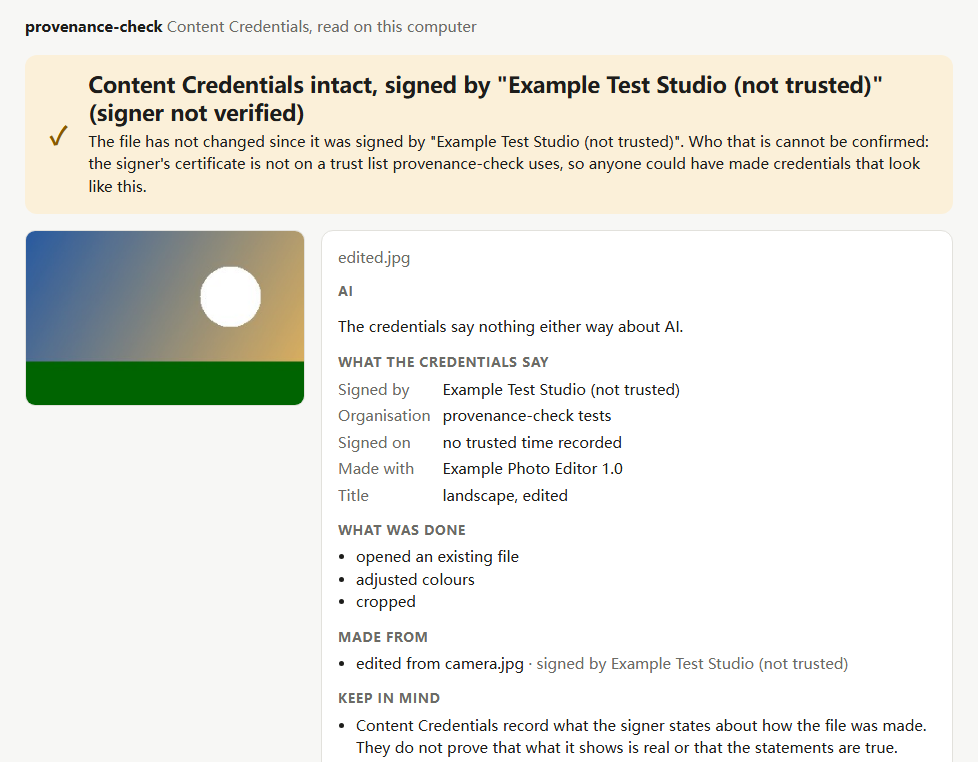
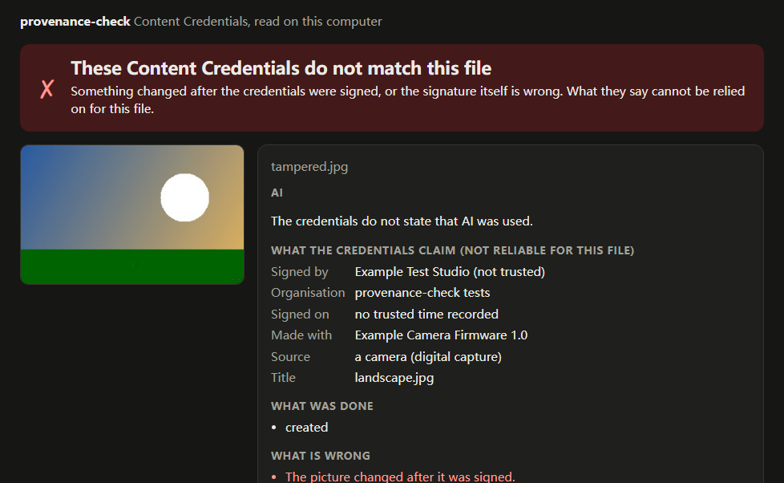

<div align="center">

# provenance-check

**右键一张图片，看看它的内容凭证（Content Credentials）说了什么。** 谁签的名、用什么工具做的、是不是 AI 生成的、做过哪些编辑、签名之后文件有没有被改过——用大白话说清楚，也说清楚这些*不能*证明什么。在你的电脑上用 C2PA 官方参考实现读取，不上传任何东西。

<a href="https://github.com/zch6a/provenance-check/actions/workflows/ci.yml"></a>

<a href="LICENSE"></a>

[English](README.md) · **简体中文**

</div>

---



## 它告诉你什么

[内容凭证](https://contentcredentials.org)（C2PA 标准）是相机、编辑软件、AI 图像生成器可以附加在文件上的签名记录。provenance-check 读取它们并告诉你（报告界面目前是英文的）：

- **签名之后文件有没有变过。** “完好”，或者“凭证与这个文件不符”，以及变了什么（画面、凭证的一部分、签名）。
- **谁签的名**，以及这个签名者能不能被确认（见下文“信任”）。
- **有没有用到 AI**——按凭证里的说法：由生成式 AI 制作、用 AI 编辑过、或者由 AI 生成的文件做成；或者凭证对 AI 只字未提。
- **怎么做出来、怎么改的**：来源（相机、生成式 AI、截图……）、工具、编辑（裁剪、调色……），以及它由哪些文件做成，每个文件各自的签名者。
- **这些不能证明什么**——每次都会说：凭证记录的是签名者的说法，不能证明画面是真实的。网上大多数图片本来就没有凭证，没有凭证不代表是假的。



## 使用

- 在网页上右键一张图片（或视频、音频），选 **Check Content Credentials**，报告会在新标签页打开。第一次检查某个网站的图片时，浏览器会请你允许 provenance-check 从这个网站（或所有网站）获取图片。
- 检查电脑上的文件：点工具栏图标，再点 **Check a file…**，把文件拖进去。
- 命令行（Node 18.3 或更新版本）：同一个读取器、同一份报告，纯文本或 `--json`：

  ```bash
  npx -y github:zch6a/provenance-check photo.jpg
  ```

  只读本地文件，可以一次检查多个。退出码：0 检查完成，1 有文件的凭证与文件不符，2 有文件无法检查（2 优先于 1；`--json` 里有每个文件各自的结果）。

## 直接问 AI 助手

provenance-check 自带一个 Agent Skill（技能）。在 Claude Code 里：

```text
/plugin marketplace add zch6a/provenance-check
/plugin install provenance-check@provenance-check
```

然后问它“这张图是 AI 生成的吗？”或者“这张照片是从哪来的？”。助手会检查文件的内容凭证，并据此如实回答：未经验证的签名者只是一个名字，不是事实；没有凭证什么也说明不了；它也不会凭图片“看起来像”去猜是不是 AI 做的。从文件夹读取技能的其他助手：把 [`plugin/skills/provenance-check`](plugin/skills/provenance-check/SKILL.md) 复制到它们的技能文件夹。

## 安装

还没有上架 Chrome 应用商店。从发布版安装：在 [Releases](https://github.com/zch6a/provenance-check/releases) 下载 `provenance-check-<版本>.zip`（0.5.0 起）并解压。或者从源码安装（需要 Node 18.3 或更新版本）：

```bash
git clone https://github.com/zch6a/provenance-check
cd provenance-check
npm ci
npm run build
```

然后打开 `chrome://extensions`（或 `edge://extensions`），打开 **开发者模式**，选 **加载已解压的扩展程序**，选择解压出来的文件夹（或 `dist`）。需要 Chrome 或 Edge 116 及以上。

## 隐私是设计出来的

- 图片在**你的电脑上**读取，用的是扩展里自带的 C2PA 官方参考实现（[c2pa-rs](https://github.com/contentauth/c2pa-rs)，编译成 WebAssembly）。不上传、不需要账号、不收集数据。
- 它唯一发出的请求，是从图片所在的网站**不带你的 cookie** 再下载一次这张图片，而且要你先允许这个网站。如果这个网站把请求重定向到别处（比如图片服务器），浏览器会跟过去，但只有对方网站允许、或者你允许了所有网站时才能拿到文件；报告会写明这份副本来自哪个主机。直接写在网页里的图片（`data:`）不需要任何请求，它在扩展内部交给报告页，不放在标签页地址里，所以不会留在你的浏览记录里。检查和显示的就是这份副本（网站可能给不同的访问者不同的文件）。
- 读取凭证的 worker **完全不能联网**。有些凭证带有身份声明（CAWG），C2PA 库会自己去查身份声明的签发者，地址由文件的制作者决定——这等于告诉他们谁打开了哪张图。worker 会拒绝扩展以外的任何请求；有一个测试在真实的 Chrome 里读这种文件，同时监视 worker 发出的请求，并且验证监视确实有效：去掉防护的对照版本用同样的方式读取，会被看到去访问签发者的地址。
- 文件里只写了一个网址、凭证存放在别处的情况（“远程清单”），它**不会**去取：取了就等于告诉那台服务器你正在看哪张图片。报告会告诉你凭证在哪，由你决定。它也不查询证书吊销状态（OCSP）。有测试检查读取过程中没有任何网络请求。
- 只申请一个权限（右键菜单）。访问网站图片的权限是可选的，用到时才申请；不在网页里运行任何脚本。
- 凭证里的文字（标题、工具名）是文件的制作者写的。报告只把它们当文字显示，绝不当 HTML 解析；会改变文字显示顺序的字符（能把 “holiday[RLO]gpj.exe” 显示成 “holidayexe.jpg”）显示为 “�”（U+FFFD）；有一张标题里带 HTML 的测试图片专门检查这一点。

## 它（暂时）做不到的

- **信任。** 还不会对照 C2PA 信任列表检查签名者，所以所有签名者都显示为“未经验证”：报告告诉你是谁签的名，由你判断这个名字。（谁都可以做一张名叫“某知名通讯社”的证书，信任列表才能分辨真假。）
- 只读文件里面的内容：不读那些指向别处凭证的隐形水印或指纹。身份声明（另外签名的“谁做的”）会显示为存在但未验证：验证它就得联系它的签发者。
- 没有凭证的图片是不是 AI 生成的，它判断不了——目前没有任何可靠的方法能判断。
- 只存在于网页内部的图片（`blob:` 地址）、从硬盘打开的图片（`file:`）以及带用户名和密码的地址都不会去获取：把图片保存下来（或者直接选择文件）再检查。文件最大 250 MB。
- 在隐身窗口里它以独立实例运行（Chrome 的 “split” 模式），报告会在那个窗口里打开；只有你在 Chrome 的扩展设置里允许，扩展才会在隐身窗口里运行。
- Firefox：暂不支持（后台脚本的写法不同）。

## 其他工具

也有其他浏览器扩展能读内容凭证，比如“C2PA Content Credentials”、Digimarc 的（开源，基于较早的 C2PA-JS 库）、Adobe 的 Content Authenticity；[contentcredentials.org/verify](https://contentcredentials.org/verify) 可以检查你上传的文件。provenance-check 适合这样的人：希望在本地检查，希望结果用大白话说清楚、也说清楚局限，希望代码少到自己能读完——MIT 许可，在参考实现之上只有几百行。

## 状态

0.6，开发中（[更新记录](CHANGELOG.md)）。测试用的是合成图片，由参考实现用仅供测试的证书签名（`test/fixtures`，由 `scripts/make-fixtures.mjs` 生成）：一张 AI 生成的图片、一张相机拍的、一张带编辑历史的、一张被篡改的、一张没有凭证的、一张凭证存放在别处的、一张文字里带 HTML 的、两张带身份声明的。构建出的扩展还会装进真实的 Chrome（全新的配置目录、不联网）做端到端检查：本地文件、`data:` 图片、权限询问、弹窗，以及读取凭证的 worker 没有发出任何请求。报告页面在浏览器里用真实的 WebAssembly 读取器检查过。

## 开发

```bash
npm ci
npm test            # 测试图片的报告、隐私（不发请求）、命令行、构建出的扩展、安装包内容、Agent Skill
npm run check       # 检查 JavaScript 的类型（JSDoc 类型，tsc）
npm run build       # 构建到 dist/
node scripts/serve.mjs   # 在扩展外打开报告页面：http://localhost:5180/dist/report.html?src=/test/fixtures/edited.jpg
```

`npm run fixtures` 重新生成测试图片（由 `scripts/cose.mjs` 签名；这个库的 WebAssembly 版本要求签名器返回完整的 COSE 签名）。`scripts/screenshot.mjs` 生成上面的截图。

怎样参与开发（以及哪些原则不能改）：[CONTRIBUTING.md](CONTRIBUTING.md)（英文）。威胁模型和如何报告漏洞：[SECURITY.md](SECURITY.md)（英文）。

## 许可证

[MIT](LICENSE)。打包了 [c2pa-web](https://github.com/contentauth/c2pa-js)（MIT，Adobe）及其依赖，构建时会把它们的许可证写进 `dist/THIRD_PARTY_LICENSES.txt`。
